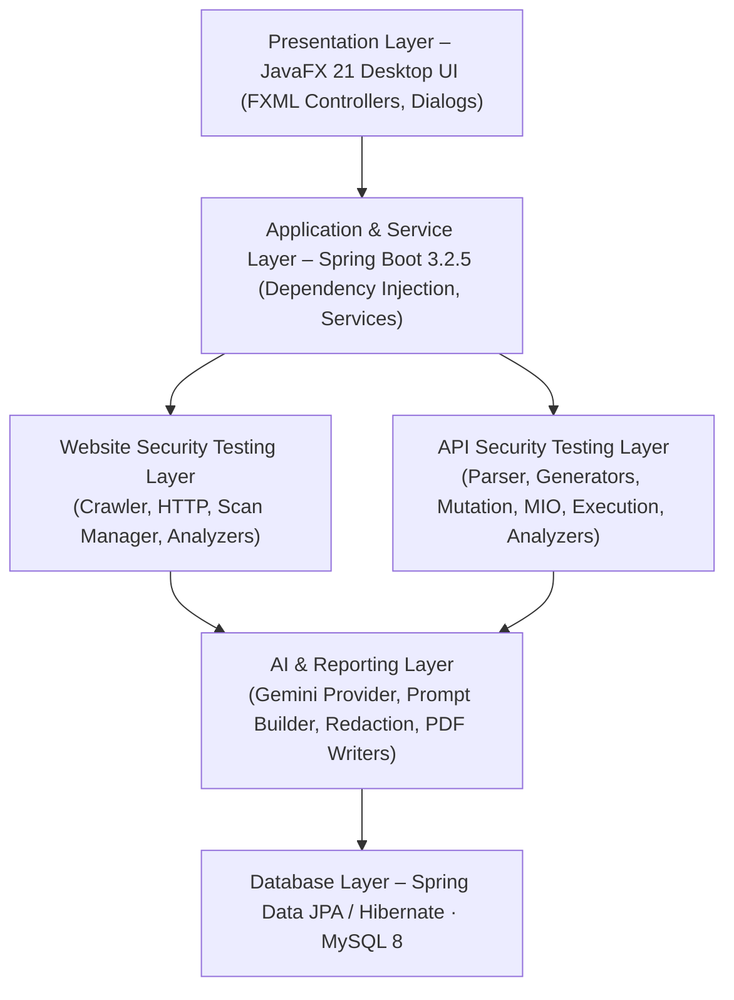

# A PROJECT REPORT ON
# WebShield – Automated Website and API Security Testing Platform

---

### Submitted by:
* **Sahithi** – AP24110011878
* **Hasini** – AP24110011843
* **Namratha** – AP24110011814
* **Aruna** – AP24110011842

**SRM University AP**  
Department of Computer Science and Engineering  
[2024–2028]  

📥 **Official Formatted PDF:** [WebShield_Project_ReportJava.pdf](WebShield_Project_ReportJava.pdf)

---

## CERTIFICATE

This is to certify that the project report entitled **“WebShield – Automated Website and API Security Testing Platform”** is a bonafide record of the work carried out by **Sahithi, Hasini, Namratha, and Aruna** at **SRM University AP**, in partial fulfilment of the requirements of the course, under the guidance of our faculty guide.

**Faculty Guide:**  
**Dr. Isunuri Bala Venkateswarlu**  
Assistant Professor  
Department of Computer Science and Engineering  
SRM University AP  

**Date:** 23-11-2026

---

## ACKNOWLEDGEMENT

We express our sincere gratitude to our faculty guide, **Dr. Isunuri Bala Venkateswarlu**, for the guidance, review, and encouragement provided throughout the development of WebShield. We also thank the faculty of the Department of Computer Science and Engineering, SRM University AP, for the facilities and academic support. Finally, we thank our team members and families for their cooperation during the design, implementation, and documentation of this project.

*Sahithi, Hasini, Namratha, Aruna*

---

## TABLE OF CONTENTS

* **Chapter 1: Introduction**
  * 1.1 Introduction
  * 1.2 Aim of the Project
  * 1.3 Objectives
  * 1.4 Advanced Features
* **Chapter 2: Individual Team Contributions**
  * 2.1 Hasini – Application Foundation, Authentication, Dashboard and Database
  * 2.2 Sahithi – Website Management, Crawling and Website Vulnerability Detection
  * 2.3 Namratha – OpenAPI Parsing, API Test Generation and Evolutionary Optimization
  * 2.4 Aruna – API Execution, Security Analysis, Regression Testing and AI Reporting
  * 2.5 Contribution Summary
* **Chapter 3: Technology Stack**
* **Chapter 4: System Architecture and Design**
  * 4.1 Overall Architecture
  * 4.2 Overall Application Workflow
  * 4.3 Website Security Testing Architecture
  * 4.4 API Security Testing Architecture
* **Chapter 5: Website Security Testing Module**
  * 5.1 Website Management
  * 5.2 Website Crawling
  * 5.3 Website Scan Management
  * 5.4 Website Vulnerability Detection (XSS, SQLi, Headers, Cookies)
  * 5.5 Finding Classification and Storage
  * 5.6 Website AI Reporting
* **Chapter 6: API Security Testing Module**
  * 6.1 API Project Creation
  * 6.2 OpenAPI and Swagger Parsing
  * 6.3 Automated API Test Generation (Valid, Boundary, Invalid, Mutation)
  * 6.4 Many-Objective Optimization (MIO)
  * 6.5 API HTTP Execution Engine
  * 6.6 API Security Analysis (OWASP API Top 10)
  * 6.7 API Findings
  * 6.8 Differential Scan and Regression Testing
  * 6.9 API AI Reporting
* **Chapter 7: Google Gemini AI Integration**
  * 7.1 Purpose of AI Integration
  * 7.2 Gemini Model and API Communication
  * 7.3 Important Classes
  * 7.4 API Key Security
  * 7.5 Sensitive Data Redaction
  * 7.6 AI Limitations
* **Chapter 8: Database Design**
  * 8.1 Database Overview
  * 8.2 Important Database Tables
  * 8.3 Database Relationships
  * 8.4 Data Persistence
* **Chapter 9: Testing and Validation**
  * 9.1 Purpose of Testing
  * 9.2 Unit Testing
  * 9.3 Functional Testing
  * 9.4 Integration Testing
  * 9.5 Test Results
* **Chapter 10: Application Demonstration**
* **Chapter 11: Conclusion and Future Enhancements**
  * 11.1 Conclusion
  * 11.2 Future Enhancements
* **Appendix A: Key Class Code and Explanation**

---

## 1. INTRODUCTION

### 1.1 Introduction
Web applications and REST APIs carry most online services, and weaknesses in them can expose sensitive data or allow unauthorized access. Website scanning and API testing normally need separate tools and considerable manual effort. We developed **WebShield**, a desktop Website and API Security Testing Platform built with Java 21, JavaFX, Spring Boot, and MySQL. It has two distinct workflows: 
1. **Website Security Testing**, which crawls an authorized website and checks for XSS indicators, SQL error indicators, missing security headers, and insecure cookies.
2. **API Security Testing**, which reads OpenAPI/Swagger specifications, generates valid, boundary, invalid, and mutated test cases, executes them, and analyzes the responses against OWASP API security standards.

### 1.2 Aim of the Project
To develop a centralized, automated platform that examines websites and REST APIs, identifies potential vulnerabilities, tracks changes between scans, and produces understandable security reports.

### 1.3 Objectives
* User registration, login, bcrypt password hashing, and session management.
* Management of authorized website targets and API projects.
* Automatic crawling to discover pages, forms, and input fields.
* Detection of XSS indicators, SQL error indicators, missing security headers, and insecure cookies.
* Import and parsing of OpenAPI and Swagger specifications.
* Generation of valid, boundary-value, invalid, and mutated API test cases.
* MIO evolutionary search to improve coverage and fault detection.
* HTTP execution with rate limiting and target-safety validation.
* Analysis of API exchanges using OWASP-aligned security rules.
* Comparison of scans to find fixed, persistent, and new findings.
* Gemini AI explanations and remediation guidance for actual findings.
* Structured PDF security assessment reports.

### 1.4 Advanced Features
* **Dual Security Testing**: Websites and REST APIs in one application.
* **Automated Crawling**: Jsoup discovers internal links, forms, and input fields.
* **Automatic API Test Generation**: Test inputs created from schema information.
* **MIO Optimization**: Evolutionary search for endpoint coverage and fault detection.
* **Gemini AI Integration**: Real HTTP requests to Gemini explain scan evidence with zero mock fallback.
* **Regression Comparison**: New, fixed, and persistent findings between two scans.
* **PDF Report Generation**: Structured, multi-page security assessment reports built via a zero-dependency PDF 1.4 engine.

---

## 2. INDIVIDUAL TEAM CONTRIBUTIONS

WebShield was divided into four work areas of equal importance. The division below is the agreed distribution of project responsibilities.

### 2.1 Hasini – Application Foundation, Authentication, Dashboard and Database
Hasini built the foundation on which the other modules run. She implemented the start-up flow: `Main.java` delegates to `MainApp.java`, which starts the Spring Boot context from `WebShieldApplication.java`, registers it in `SpringContext.java`, and opens the JavaFX login screen. She developed user registration and login with password-policy validation and bcrypt hashing (`jBCrypt`), together with session management. She also created the unified Security Command Center dashboard, which shows website, API project, and scan counts, the website security overview, and recent activity. She configured database access and persistence with JPA entities and repositories for users, websites, scans, and API projects. These parts give the other three modules a working interface, authenticated users, and a common data store.

### 2.2 Sahithi – Website Management, Crawling and Website Vulnerability Detection
Sahithi implemented the complete website testing workflow. She developed website target registration with URL validation, so only authorized targets are stored. She built the Jsoup-based crawler (`WebCrawler`, `PageFetcher`, `FormExtractor`, `CrawlBoundary`), which starts at the root URL, follows internal links within the domain boundary, and extracts forms, methods, and input fields. She implemented the scan manager and scan task that run scans on background threads and report progress. She also created the assessment checks for input reflection (XSS indicators), SQL error indicators, security headers, and cookie attributes, the classification and deduplication of findings, and their storage and display in the Reports screen with severity, URL, parameter, confidence, and evidence.

### 2.3 Namratha – OpenAPI Parsing, API Test Generation and Evolutionary Optimization
Namratha prepared and optimized the API test cases. She implemented API project creation and specification import (file upload or URL) and the `OpenApiParser`, which uses Swagger Parser to extract endpoints, HTTP methods, path, query, and header parameters, request bodies, schema types, required fields, and responses into `ParsedApiSpecification`. She built `ApiTestGenerator` with `ValidInputGenerator`, `BoundaryValueGenerator`, and `InvalidInputGenerator`, and the `MutationEngine` with its mutation operators for type, boundary, security-payload, and JSON-structure changes. She also implemented the MIO evolutionary search (`EvolutionaryTestEngine`, `MioAlgorithm`) with `CoverageFitnessFunction` and `FaultDetectionFitnessFunction`, which improve the test suite over several generations.

### 2.4 Aruna – API Execution, Security Analysis, Regression Testing and AI Reporting
Aruna implemented the execution and evaluation of API tests. `ApiExecutionEngine` sends the generated requests with Java `HttpClient`, controlled by `RateLimiter` and `TargetSafetyValidator`, and records status codes, response times, and bodies. She built `ApiSecurityAnalyzer` and its rule classes for authentication, authorization (BOLA and IDOR indicators), misconfiguration, sensitive data exposure, input validation, injection indicators, and HTTP/CORS issues, with CWE mapping. She developed scan comparison through `ApiPersistenceService` and `ApiScanComparisonController`. She also integrated Google Gemini (`GeminiLlmProvider`, `LlmPromptBuilder`, `LlmService`), the `RedactionUtils` evidence redaction, `WebsiteAiReportService`, and the PDF writers `SimplePdfWriter` and `WebsiteReportPdfWriter`.

### 2.5 Contribution Summary
| Member | Main Area | Major Responsibilities |
| :--- | :--- | :--- |
| **Hasini** | Application Foundation | Application setup, authentication, dashboard, database and persistence |
| **Sahithi** | Website Security | Website management, crawling, scanning, vulnerability detection and findings |
| **Namratha** | API Test Preparation | OpenAPI parsing, test generation, mutation and MIO optimization |
| **Aruna** | API Analysis & Reporting | Test execution, OWASP analysis, regression comparison, Gemini integration and PDF reports |

All four members contributed to developing and integrating the complete WebShield platform, and each work area was required for the application to function end to end.

---

## 3. TECHNOLOGY STACK

| Technology | Version | Why it was used | Where used in WebShield |
| :--- | :--- | :--- | :--- |
| **Java** | 21 LTS | Main language with records and built-in HttpClient | Whole application |
| **JavaFX** | 21.0.2 | Native desktop UI toolkit with FXML and CSS | Screens, controllers, dialogs |
| **Spring Boot** | 3.2.5 | Dependency injection and application framework | Services, repositories, SpringContext |
| **Spring Data JPA / Hibernate**| Managed by 3.2.5 | Object-relational mapping and repositories | Entities and repository classes |
| **MySQL / Connector/J** | 8.x / 8.3.0 | Relational storage of targets, scans, and findings | Database layer |
| **HikariCP** | 5.1.0 | JDBC connection pooling | Database configuration |
| **Jsoup** | 1.17.2 | HTML parsing of pages, links, and forms | WebCrawler, PageFetcher, FormExtractor |
| **Swagger Parser** | 2.1.20 | Parses OpenAPI 3.x and Swagger 2.0 (JSON, YAML) | OpenApiParser |
| **Jackson Databind / SnakeYAML** | 2.17.0 | JSON and YAML processing | Payloads, specifications, Gemini JSON |
| **jBCrypt** | 0.4 | Salted one-way password hashing | PasswordService |
| **Java HTTP Client** | Java 21 | Asynchronous request/response handling | Crawling, API execution, Gemini calls |
| **Google Gemini API** | `gemini-3.1-flash-lite` (v1beta REST) | Explanations and remediation guidance | GeminiLlmProvider |
| **SimplePdfWriter (custom)** | PDF 1.4 | PDF output without third-party libraries | API and website PDF reports |
| **SLF4J / Logback** | 2.0.12 / 1.5.3 | Structured application logging | All modules |
| **JUnit 5 / Mockito** | 5.10.2 / 5.11.0 | Unit tests and dependency isolation | src/test/java |

---

## 4. SYSTEM ARCHITECTURE AND DESIGN

### 4.1 Overall Architecture
WebShield follows a layered architecture:
* **Presentation Layer**: JavaFX 21 interface for login, website management, API import, scan configuration, findings, comparison, and reports.
* **Application and Service Layer**: Coordinates user actions, with Spring Boot providing dependency injection.
* **Website Security Testing Layer**: Contains the crawler, HTTP components, scan manager, and analyzers.
* **API Security Testing Layer**: Contains the parser, generators, mutation engine, MIO search, execution engine, and API analyzer.
* **AI and Reporting Layer**: Contains the Gemini integration and PDF writers.
* **Database Layer**: Spring Data JPA / Hibernate on MySQL 8.



### 4.2 Overall Application Workflow
1. User opens WebShield
2. Register / Login
3. Dashboard overview
4. Choose Website or API testing
5. Configure target
6. Run testing engine
7. Analyze results
8. Store and display findings
9. Compare scans (API)
10. Generate / download report

---

## 5. WEBSITE SECURITY TESTING MODULE

* **Website Management**: Target registration with URL validation (ensures valid `http`/`https` syntax and authorized domains).
* **Website Crawling**: Jsoup-based crawler starting at the root URL, discovering in-scope links, and extracting forms and input parameters.
* **Scan Management**: `ScanManager` dispatches background `ScanTask` worker threads, keeping the desktop UI responsive with live status telemetry.
* **Vulnerability Analyzers**:
  * *XSS Detection*: Canary token reflection (`ws_probe_...`) verifying unencoded reflection in HTTP responses.
  * *SQL Injection*: Submitting metacharacters and detecting MySQL, Postgres, MSSQL, Oracle, and SQLite error signatures.
  * *Security Headers*: Checking for missing `Content-Security-Policy`, `Strict-Transport-Security`, `X-Frame-Options`, and `X-Content-Type-Options`.
  * *Cookie Attributes*: Flagging missing `Secure`, `HttpOnly`, and `SameSite` flags.
* **AI Report Generation**: `WebsiteAiReportService` gathers findings, scrubs sensitive data with `RedactionUtils`, prompts Google Gemini, and exports a 10-section PDF via `WebsiteReportPdfWriter`.

---

## 6. API SECURITY TESTING MODULE

* **OpenAPI / Swagger Ingestion**: Parses JSON/YAML files and URLs using Swagger Parser v3 with remote entity resolution disabled for SSRF protection.
* **Autonomous Test Generation**:
  * *Valid Inputs*: Type-conforming data.
  * *Boundary Values*: Min/max numbers, length limits, character overflows.
  * *Invalid Inputs*: Type mismatches, missing required fields, null injection.
  * *Mutation Fuzzing*: `MutationEngine` applying bit, regex, syntax, and structural modifications.
* **Many-Objective Optimization (MIO)**: Generational evolutionary search optimizing test suites for endpoint coverage and fault discovery.
* **Asynchronous HTTP Fuzzer**: Java 21 `HttpClient` executing requests under token-bucket rate limiting and safety bounds.
* **OWASP API Rules Evaluation**: Checks against API1 (BOLA), API2 (Broken Auth), API3 (Sensitive Data Exposure), API4 (Resource Consumption), API8 (Misconfiguration), and API10 (Unsafe Consumption).
* **Differential Regression Analysis**: Version-to-version diffing identifying New Regressions, Resolved Vulnerabilities, and Persistent Findings.

---

## 7. GOOGLE GEMINI AI INTEGRATION

* **Model**: Direct REST calls to Google AI Studio `gemini-3.1-flash-lite` (v1beta REST endpoint).
* **Zero Mock Fallback**: Strict production integration; no simulated responses or mock fallbacks are used.
* **Key Security**: Managed via the `GEMINI_API_KEY` environment variable.
* **Data Sanitization**: `RedactionUtils` strips passwords, bearer tokens, API keys, and session cookies before LLM dispatch.
* **Parallel Batching**: `LlmService` groups findings by vulnerability title, executing parallel asynchronous requests to minimize latency.

---

## 8. DATABASE DESIGN

WebShield uses a relational schema deployed on **MySQL 8**:
* `users`: User credentials and bcrypt password hashes.
* `websites`: Registered target URLs.
* `scans`: Website assessment runs and risk scores.
* `discovered_pages`, `forms`, `input_fields`: Crawl surface data.
* `scan_findings`: Website vulnerability findings.
* `api_projects`: Ingested OpenAPI/Swagger specifications.
* `api_scans`: API testing sessions and metrics.
* `api_executions`: Full HTTP traffic logs (request/response headers and bodies).
* `api_findings`: Detected API vulnerabilities mapped to OWASP and CWE.
* `api_test_case_results`: Individual test execution assertions.
* `api_scan_statistics`: Aggregated severity and coverage metrics.
* `api_reports`: Stored report metadata.

---

## 9. TESTING AND VALIDATION

* **Unit Testing**: Over 408 automated unit tests built with JUnit 5 and Mockito in `src/test/java`.
* **Functional & Integration Testing**: End-to-end verification covering registration, website crawling, vulnerability detection, OpenAPI parsing, test case generation, MIO search, rate-limited HTTP execution, differential comparison, and PDF generation.

---

## 10. APPLICATION DEMONSTRATION & SCREENSHOTS

1. **Figure 10.1: Registration Screen** – User account creation with strong password policy.
2. **Figure 10.2: Security Command Center Dashboard** – Unified multi-engine metrics and website security overview.
3. **Figure 10.3: Websites Screen** – Table of authorized scan targets.
4. **Figure 10.4: Security Scans Screen** – Live crawling and vulnerability scan progress with real-time logs.
5. **Figure 10.5: Scan History Screen** – Historical scans with AI Report generation button.
6. **Figure 10.6: Website Findings Screen** – Severity breakdown, findings table, and details panel.
7. **Figure 10.7: API Projects Screen** – Ingested OpenAPI specifications.
8. **Figure 10.8: Test Configuration Screen** – Strategy checkboxes, mutation sliders, and MIO settings.
9. **Figure 10.9: API Scan Execution Console** – Live telemetry, tests generated, and execution progress.
10. **Figure 10.10: Generated Test Cases Screen** – Test cases with generation strategy and mutation lineage.
11. **Figure 10.11: HTTP Execution Results Screen** – Raw request/response traffic logs with sanitized data.
12. **Figure 10.12: API Security Findings Screen** – Findings classified by OWASP category, CWE, and remediation.
13. **Figure 10.13: API Scan History Screen** – Scan records with durations and finding totals.
14. **Figure 10.14: Scan Comparison Screen** – Differential analysis with New Regressions, Resolved, and Persistent findings.
15. **Figure 10.15: API Reports Screen** – Report configuration with AI-assisted explanation option and PDF generation.

---

## 11. CONCLUSION AND FUTURE ENHANCEMENTS

### 11.1 Conclusion
WebShield delivers an automated, local-first platform combining website crawling, vulnerability checks, OpenAPI test generation, MIO optimization, HTTP test execution, regression comparison, AI-assisted reporting, and zero-dependency PDF generation.

### 11.2 Future Enhancements
* Additional vulnerability checks (e.g., SSRF, Race Conditions).
* Headless browser integration for dynamic JavaScript-heavy single-page applications (SPAs).
* GraphQL and gRPC specification support.
* CI/CD pipeline integration plugins (GitHub Actions, Jenkins).

---

## APPENDIX A: KEY CLASS CODE AND EXPLANATION

### A.1 MainApp (Hasini – Application Foundation)
**Package**: `com.webshield`  
**Purpose**: Integrates JavaFX with Spring Boot and manages the application lifecycle.

```java
public class MainApp extends Application {
    private static final String APP_TITLE = "WebShield – Security Assessment Platform";

    @Override
    public void init() throws Exception {
        String[] args = getParameters() != null && getParameters().getRaw() != null
                ? getParameters().getRaw().toArray(new String[0]) : new String[0];
        // Bootstrap Spring container in non-web mode for desktop usage
        ConfigurableApplicationContext context = new SpringApplicationBuilder(WebShieldApplication.class)
                .headless(false)
                .web(WebApplicationType.NONE)
                .run(args);
        SpringContext.setApplicationContext(context);
    }

    @Override
    public void start(Stage stage) {
        FXMLLoader loader = SpringContext.createLoader(getClass().getResource("/fxml/pages/login.fxml"));
        Parent root = loader.load();
        Scene scene = new Scene(root, 820.0, 620.0);
        scene.getStylesheets().add(getClass().getResource("/css/styles.css").toExternalForm());
        stage.setTitle(APP_TITLE);
        stage.setScene(scene);
        stage.show();
    }
}
```

---

### A.2 InputReflectionAnalyzer (Sahithi – Website Security)
**Package**: `com.webshield.assessment.analyzers`  
**Purpose**: Detects reflected input (XSS indicator) on crawled pages using safe canary tokens.

```java
@Component
public class InputReflectionAnalyzer implements AssessmentRule {
    private final ParameterExtractor paramExtractor = new ParameterExtractor();

    @Override
    public List<AssessmentResult> probe(AssessmentContext context, DiscoveredPage page) {
        List<AssessmentResult> results = new ArrayList<>();
        Map<String, List<String>> queryParams = paramExtractor.extractQueryParameters(page.getUrl());

        // Probe query parameters with safe, unique canary tokens
        for (String param : queryParams.keySet()) {
            String canary = "ws_probe_" + UUID.randomUUID().toString().substring(0, 8);
            String probeUrl = replaceQueryParam(page.getUrl(), param, canary);
            HttpRequestData req = HttpRequestBuilder.get(probeUrl).timeout(10).build();
            HttpResponseData res = context.getHttpManager().execute(req, targetDomain);

            // Check if the canary is echoed unencoded in the HTTP response body
            if (res != null && res.getBody() != null && res.getBody().contains(canary)) {
                results.add(new AssessmentResult(
                    "Unfiltered Parameter Reflection (XSS Indicator)", "Input Handling",
                    "WS-REF-002", probeUrl, param, "GET", Severity.HIGH, ConfidenceLevel.HIGH,
                    "The input parameter '" + param + "' was reflected verbatim in the response body.",
                    "Canary Token: " + canary, "Active Canary Probe",
                    "Contextually encode user inputs using HTML entity encoding before rendering."));
            }
        }
        return results;
    }
}
```

---

### A.3 OpenApiParser (Namratha – API Test Preparation)
**Package**: `com.webshield.api.parser`  
**Purpose**: Converts an OpenAPI/Swagger specification into an internal normalized model.

```java
public class OpenApiParser {
    public ParsedApiSpecification parse(String rawSpec) {
        ParseOptions options = new ParseOptions();
        // Defensive security: prevent SSRF during parsing by disabling remote entity resolution
        options.setResolve(false);
        options.setResolveFully(false);

        SwaggerParseResult parseResult = new OpenAPIParser().readContents(rawSpec, null, options);
        if (parseResult == null || parseResult.getOpenAPI() == null) {
            throw new OpenApiParseException("Failed to parse OpenAPI/Swagger specification.");
        }

        OpenAPI openAPI = parseResult.getOpenAPI();
        OpenApiMetadata metadata = extractMetadata(openAPI);
        SchemaResolver resolver = new SchemaResolver(openAPI);
        SchemaExtractor schemaExtractor = new SchemaExtractor(resolver);
        EndpointExtractor endpointExtractor = new EndpointExtractor(openAPI, resolver, schemaExtractor);

        List<ApiEndpoint> endpoints = endpointExtractor.extractEndpoints();
        return new ParsedApiSpecification(metadata, endpoints, parseResult.getMessages(), rawSpec);
    }
}
```

---

### A.4 ApiExecutionEngine (Aruna – API Execution)
**Package**: `com.webshield.api.execution`  
**Purpose**: Executes generated test cases against the target API with rate limiting and safety validation.

```java
public ApiExecutionResponse execute(ApiExecutionRequest request) {
    String executionId = UUID.randomUUID().toString();
    URI targetUri;

    // 1. Safety verification: prevent SSRF and out-of-scope requests
    try {
        targetUri = new URI(request.fullUrl());
        safetyValidator.validateTarget(targetUri, false, null);
    } catch (Exception e) {
        return ApiExecutionResponse.failure(executionId, request.testCaseId(),
                ExecutionOutcome.POLICY_BLOCKED, e.getMessage());
    }

    // 2. Concurrency & Rate Limiter Control
    boolean permitAcquired = false;
    try {
        permitAcquired = concurrencySemaphore.tryAcquire(5, TimeUnit.SECONDS);
        if (!permitAcquired) {
            return ApiExecutionResponse.failure(executionId, request.testCaseId(),
                    ExecutionOutcome.TIMEOUT, "Concurrency timeout");
        }
        rateLimiter.acquire(); // Enforces configured Queries-Per-Second (QPS)

        // 3. Dispatch HTTP Request using Java 21 HttpClient
        HttpRequest nativeReq = HttpRequest.newBuilder()
                .uri(targetUri)
                .method(request.httpMethod(), HttpRequest.BodyPublishers.ofString(request.body()))
                .timeout(Duration.ofSeconds(10)).build();

        long start = System.currentTimeMillis();
        HttpResponse<String> resp = httpClient.send(nativeReq,
                HttpResponse.BodyHandlers.ofString(StandardCharsets.UTF_8));
        long duration = System.currentTimeMillis() - start;

        return ApiExecutionResponse.builder()
                .executionId(executionId).statusCode(resp.statusCode())
                .responseBody(resp.body()).executionDurationMs(duration)
                .outcome(ExecutionOutcome.SUCCESS).build();
    } catch (Exception e) {
        return ApiExecutionResponse.failure(executionId, request.testCaseId(),
                ExecutionOutcome.EXECUTION_ERROR, e.getMessage());
    } finally {
        if (permitAcquired) concurrencySemaphore.release();
    }
}
```

---

### A.5 ApiSecurityAnalyzer (Aruna – Security Analysis)
**Package**: `com.webshield.api.analysis`  
**Purpose**: Coordinates the evaluation of OWASP API security rules with complete fault isolation.

```java
@Service
public class ApiSecurityAnalyzer {
    private final List<ApiSecurityRule> rules = new CopyOnWriteArrayList<>();

    public ApiSecurityAnalyzer() {
        // Register all built-in OWASP API Top 10 security rules
        rules.addAll(List.of(
                new SensitiveDataExposureRule(),
                new SecurityMisconfigurationRule(),
                new AuthenticationWeaknessRule(),
                new AuthorizationWeaknessRule(),
                new InjectionIndicatorRule(),
                new InputValidationRule(),
                new HttpProtocolRule()));
    }

    public List<ApiSecurityFinding> analyze(ApiExecutionRequest req, ApiExecutionResponse res) {
        List<ApiSecurityFinding> findings = new ArrayList<>();
        for (ApiSecurityRule rule : rules) {
            try {
                // Fault isolation: one rule failing does not crash the analysis pipeline
                List<ApiSecurityFinding> detected = rule.evaluate(req, res);
                if (detected != null && !detected.isEmpty()) findings.addAll(detected);
            } catch (Exception e) { /* log rule failure and continue */ }
        }
        return deduplicateFindings(findings);
    }
}
```
